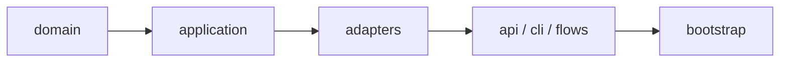

# Visão geral da arquitetura

Ver §3 da [especificação](../especificacao.md).

As setas indicam "é usado por". Contratos verificados por `make arch`.

## Referência do domínio

::: ipsurvey.domain.models.core
