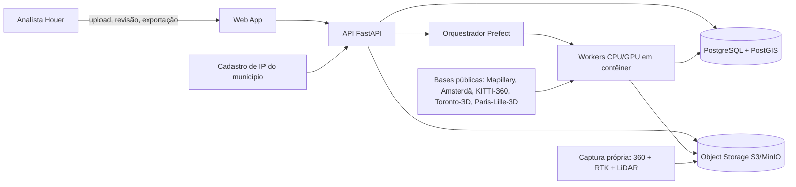

# Especificação de Desenvolvimento: Plataforma de Levantamento Móvel de Ativos de IP

**Projeto:** `ip-mobile-survey` (nome provisório)
**Responsável técnico:** Houer Consultoria e Concessões
**Versão do documento:** 0.1, de 19/11/2026
**Status:** base para o início do desenvolvimento (Sprint 0)

> Este documento é a **fonte de verdade técnica** do projeto. Mudanças de arquitetura entram aqui por meio de um ADR (*Architecture Decision Record*, ver §14.3), nunca só no código.

---

## Sumário

1. [Propósito e escopo](#1-propósito-e-escopo)
2. [Princípios de engenharia](#2-princípios-de-engenharia)
3. [Visão geral da arquitetura](#3-visão-geral-da-arquitetura)
4. [Stack tecnológica](#4-stack-tecnológica)
5. [Organização de pastas (monorepo)](#5-organização-de-pastas-monorepo)
6. [Modelo de domínio e contratos de dados](#6-modelo-de-domínio-e-contratos-de-dados)
7. [Pipeline de processamento](#7-pipeline-de-processamento)
8. [Adaptadores de fontes de dados](#8-adaptadores-de-fontes-de-dados)
9. [Algoritmos de extração e critérios de aceite](#9-algoritmos-de-extração-e-critérios-de-aceite)
10. [Persistência e armazenamento](#10-persistência-e-armazenamento)
11. [Infraestrutura e execução em nuvem](#11-infraestrutura-e-execução-em-nuvem)
12. [Eficiência e desempenho](#12-eficiência-e-desempenho)
13. [Qualidade: testes, métricas e regressão](#13-qualidade-testes-métricas-e-regressão)
14. [Documentação](#14-documentação)
15. [Segurança, LGPD e licenças](#15-segurança-lgpd-e-licenças)
16. [GitHub: criação do repositório, branches e fluxo de trabalho](#16-github-criação-do-repositório-branches-e-fluxo-de-trabalho)
17. [CI/CD](#17-cicd)
18. [Roadmap de desenvolvimento (sprints)](#18-roadmap-de-desenvolvimento-sprints)
19. [Itens críticos](#19-itens-críticos)
20. [Riscos](#20-riscos)
21. [Glossário](#21-glossário)
22. [Referências](#22-referências)

---

## 1. Propósito e escopo

### 1.1 Propósito

Construir uma plataforma que recebe capturas móveis (imagens 360°, trajetória GNSS/RTK e, opcionalmente, LiDAR). A plataforma processa essas capturas em nuvem e entrega, por poste e por vão, os atributos estruturais da rede de iluminação pública, associados ao cadastro e com nível de confiança declarado.

### 1.2 Escopo do MVP (v0.x)

> **Atualizado pelo [ADR 0006](adr/0006-escopo-inspecao-unica.md):** inspeção única por município, com um registro por **ponto de IP**. A saída canônica é a planilha de inspeção (colunas B–AW da aba Simulações), confrontada com o cadastro atual.

| Incluído | Fora do MVP (fases seguintes) |
|---|---|
| Ingestão de capturas (bases públicas e captura própria) | Medição fotométrica (módulo luxímetro, que tem plano próprio) |
| Trajetória e georreferenciamento | Classificação de modelo exato de luminária (no MVP só a família) |
| Reconstrução 3D (fotogrametria; LiDAR quando houver) | App de campo mobile nativo |
| Detecção de postes, luminárias e braços nas imagens | Integração com telegestão |
| Extração: posição, espaçamento S, altura H, inclinação do poste, projeção do braço, largura da pista W | Largura do passeio e copa de árvores (v1.1) |
| Associação ao cadastro e relatório de divergências | Multi-tenant, faturamento |
| Revisão humana (web) dos itens de baixa confiança | |
| Exportação (GeoPackage, CSV, GeoJSON) | |

### 1.3 Usuários

- **Analista de campo/escritório (Houer):** sobe capturas, revisa resultados, exporta.
- **Engenheiro responsável:** aprova a campanha e assina o relatório.
- **Leitor externo (poder concedente / concessionária):** fase futura, somente leitura.

---

## 2. Princípios de engenharia

1. **Correto antes de rápido, rápido antes de bonito.** Precisão medida é o produto. Nenhum algoritmo entra sem métrica contra verdade de campo.
2. **Reprodutibilidade total.** Os mesmos dados de entrada, com a mesma versão de código e os mesmos parâmetros, devem produzir o mesmo resultado. Todo artefato registra `pipeline_version`, `params_hash` e `input_hash`.
3. **Dado bruto é imutável.** Nada sobrescreve o bruto; as etapas produzem artefatos novos e versionados.
4. **Etapas idempotentes e retomáveis.** Rodar uma etapa duas vezes não duplica nada. Se uma máquina spot cair, retoma-se do último trecho concluído.
5. **Domínio isolado da infraestrutura (arquitetura hexagonal).** Algoritmos não conhecem S3, banco ou fila; recebem e devolvem objetos do domínio.
6. **Contratos explícitos.** Toda fronteira (API, arquivo, etapa) tem esquema tipado (Pydantic) e versionado.
7. **Tipagem estrita e lint obrigatório.** O CI barra o merge se falhar.
8. **Observabilidade desde o dia 1:** logs estruturados, métricas por etapa e rastreio por `run_id`.
9. **Documentação viva:** docstrings, ADRs e docs gerados do código, no mesmo PR da mudança.
10. **Simplicidade:** sem microserviços no MVP. Um monorepo com módulos bem separados; escalar quando houver medição que justifique.

---

## 3. Visão geral da arquitetura

### 3.1 Contexto (C4 nível 1)



### 3.2 Arquitetura hexagonal (portas e adaptadores)

```
                ┌────────────────────────────────────────────┐
                │                 DOMÍNIO                    │
                │  entidades, value objects, regras,         │
                │  algoritmos puros (geometria, extração)    │
                └──────────────▲─────────────▲───────────────┘
                               │ portas (interfaces/Protocol)
      ┌────────────────────────┴──┐       ┌──┴─────────────────────────┐
      │ ADAPTADORES DE ENTRADA    │       │ ADAPTADORES DE SAÍDA       │
      │ - API REST (FastAPI)      │       │ - Repositórios PostGIS     │
      │ - CLI (Typer)             │       │ - Object storage (S3)      │
      │ - Flows Prefect           │       │ - Motores externos (COLMAP,│
      │                           │       │   detector, SLAM)          │
      │                           │       │ - Fontes de dados (Mapillary│
      │                           │       │   KITTI-360, captura própria)│
      └───────────────────────────┘       └────────────────────────────┘
```

**Regras de dependência (verificadas automaticamente com `import-linter` no CI):**

- `domain` não importa nada de `adapters`, `infra`, `api` ou `flows`.
- `application` (casos de uso) importa `domain` e as portas, nunca implementações concretas.
- `adapters` implementam as portas e podem importar bibliotecas externas.
- A composição (injeção de dependências) acontece só em `bootstrap.py`.

### 3.3 Camadas

| Camada | Responsabilidade | Exemplos |
|---|---|---|
| `domain` | Entidades, regras e algoritmos puros, sem I/O | `Pole`, `Span`, `extract_pole_axis()`, `compute_nbr_grid()` |
| `application` | Casos de uso que orquestram o domínio pelas portas | `ProcessSegment`, `AssociateToCadastre`, `ExportCampaign` |
| `ports` | Interfaces (`typing.Protocol`) | `ImageSource`, `PointCloudStore`, `Reconstructor`, `Detector`, `PoleRepository` |
| `adapters` | Implementações concretas das portas | `MapillarySource`, `Kitti360Source`, `ColmapReconstructor`, `PostgisPoleRepository` |
| `flows` | Orquestração Prefect (retries, cache, paralelismo) | `campaign_flow`, `segment_flow` |
| `api` | HTTP (FastAPI) e autenticação | `/campaigns`, `/poles`, `/reviews` |
| `web` | Front-end de revisão | Mapa + visualizador 360 + fila de revisão |

---

## 4. Stack tecnológica

> Escolhas padrão. Trocar qualquer item exige um ADR.

| Área | Escolha | Motivo |
|---|---|---|
| Linguagem principal | **Python 3.12** | Ecossistema geoespacial, visão computacional e 3D |
| Gerência de projeto/deps | **uv** (lockfile `uv.lock`) | Rápido, reprodutível e com suporte a workspaces |
| Lint/format | **ruff** (lint + format) | Padrão de mercado, muito rápido |
| Tipagem | **mypy --strict** nos pacotes `domain` e `application` | Erros de contrato pegos antes do runtime |
| Contratos/validação | **Pydantic v2** | Esquemas tipados para API, arquivos e configurações |
| Configuração | **pydantic-settings** + `.env` (nunca versionado) | Configuração por ambiente |
| Testes | **pytest**, **hypothesis** (propriedades), **pytest-cov**, **testcontainers** (PostGIS/MinIO reais) | Teste com dependências reais, sem mocks frágeis |
| Arquitetura | **import-linter** | Garante as regras de dependência |
| API | **FastAPI** + **Uvicorn** | Tipado, OpenAPI automático |
| Banco | **PostgreSQL 16 + PostGIS 3** | Padrão geoespacial |
| ORM/migrações | **SQLAlchemy 2.0** + **GeoAlchemy2** + **Alembic** | Maduro e tipado |
| Armazenamento de objetos | **S3** (produção) / **MinIO** (local) via `boto3` | Mesmo código nos dois ambientes |
| Orquestração | **Prefect 3** | Retries, cache por hash, concorrência, UI; mais simples que Airflow para lote |
| Geometria/geodésia | numpy, scipy, shapely 2, pyproj, geopandas | Padrão |
| Nuvem de pontos | **Open3D**, **PDAL**, laspy (LAS/LAZ) | Padrão aberto |
| Fotogrametria | **COLMAP** (contêiner com CUDA) e, como alternativa, OpenSfM | Licenças permissivas (verificar, §15.3) |
| SLAM LiDAR (opcional) | FAST-LIO2 (contêiner ROS 2) | Uso interno no servidor (GPL, §15.3) |
| Detecção/segmentação | **RT-DETR via transformers / Detectron2 / MMDetection** (Apache-2.0) + **SAM 2** (Apache-2.0) | **Evitar Ultralytics YOLO (AGPL)** sem licença comercial |
| Treinamento/inferência | PyTorch, ONNX Runtime para inferência | Inferência eficiente e portátil |
| Rotulagem | CVAT (auto-hospedado) ou Label Studio | Base de imagens rotuladas própria |
| Formatos | Parquet (tabelas), LAZ/COPC (nuvens), JPEG/WebP (panoramas), GeoPackage (exportação) | Abertos e eficientes |
| Logs/observabilidade | **structlog** (JSON), **OpenTelemetry**, Prometheus/Grafana (fase 2), Sentry (opcional) | Rastreio por `run_id` |
| Front-end | **React + TypeScript + Vite**, **MapLibre GL**, **Marzipano/Pannellum** (360) | Abertos e leves |
| Contêineres | Docker, imagens multi-stage; `docker compose` local | Paridade entre ambientes |
| IaC (fase 2) | Terraform | Infraestrutura versionada |
| Docs | **MkDocs Material** + mkdocstrings, diagramas Mermaid | Documentação gerada a partir do código |

---

## 5. Organização de pastas (monorepo)

```
ip-mobile-survey/
├── .github/
│   ├── workflows/
│   │   ├── ci.yml                 # lint, tipos, testes, arquitetura
│   │   ├── docker.yml             # build/push de imagens (tags)
│   │   ├── docs.yml               # publica MkDocs no GitHub Pages
│   │   └── release.yml            # release-please (versionamento automático)
│   ├── ISSUE_TEMPLATE/
│   │   ├── bug.yml
│   │   ├── feature.yml
│   │   └── experiment.yml         # hipótese, métrica, resultado
│   ├── PULL_REQUEST_TEMPLATE.md
│   ├── CODEOWNERS
│   └── dependabot.yml
├── docs/                          # MkDocs
│   ├── index.md
│   ├── architecture/
│   │   ├── overview.md            # C4 + hexagonal
│   │   ├── data-contracts.md
│   │   └── pipeline.md
│   ├── adr/                       # Architecture Decision Records
│   │   ├── 0000-template.md
│   │   ├── 0001-monorepo-python-uv.md
│   │   └── 0002-prefect-orquestracao.md
│   ├── algorithms/                # um arquivo por algoritmo, com método e métricas
│   ├── runbooks/                  # operação: subir campanha, reprocessar, incidentes
│   └── datasets.md                # bases públicas, licenças, como baixar
├── src/
│   └── ipsurvey/                  # pacote Python principal
│       ├── __init__.py
│       ├── bootstrap.py           # composição de dependências (único lugar)
│       ├── settings.py            # pydantic-settings
│       ├── domain/
│       │   ├── models/            # entidades e value objects (Pole, Span, Trajectory…)
│       │   ├── geometry/          # transformações, projeções equirretangulares, PCA
│       │   ├── extraction/        # algoritmos puros de extração (poste, braço, meio-fio)
│       │   ├── nbr5101/           # malha NBR, regras de classe (compartilhado com o módulo fotométrico)
│       │   └── quality/           # cálculo de confiança, regras de aceite
│       ├── application/
│       │   ├── ports.py           # Protocols (interfaces)
│       │   └── use_cases/         # ingest_capture.py, process_segment.py, associate.py, export.py
│       ├── adapters/
│       │   ├── sources/           # mapillary.py, amsterdam.py, kitti360.py, toronto3d.py, own_capture.py
│       │   ├── reconstruction/    # colmap.py, opensfm.py, fastlio.py
│       │   ├── detection/         # rtdetr.py, sam.py
│       │   ├── storage/           # s3.py
│       │   └── persistence/       # postgis/ (repositórios SQLAlchemy)
│       ├── flows/                 # Prefect: campaign_flow.py, segment_flow.py
│       ├── api/                   # FastAPI: routers/, schemas/, deps.py, main.py
│       └── cli/                   # Typer: `ipsurvey ingest|process|export|bench`
├── web/                           # front-end React/TS (revisão)
│   ├── src/
│   └── package.json
├── migrations/                    # Alembic
├── containers/
│   ├── api.Dockerfile
│   ├── worker-cpu.Dockerfile
│   ├── worker-gpu.Dockerfile      # CUDA + COLMAP + PyTorch
│   └── slam.Dockerfile            # ROS 2 + FAST-LIO2 (opcional)
├── infra/
│   ├── docker-compose.yml         # postgres/postgis, minio, prefect, api, worker
│   └── terraform/                 # fase 2
├── tests/
│   ├── unit/                      # domínio puro, rápido (< 30 s no total)
│   ├── property/                  # hypothesis (invariantes geométricas)
│   ├── integration/               # testcontainers: PostGIS, MinIO
│   ├── e2e/                       # pipeline completo num mini-dataset
│   └── fixtures/                  # dados pequenos versionados (< 5 MB no total)
├── benchmarks/
│   ├── golden/                    # manifests dos datasets de referência (sem os dados)
│   └── run_bench.py               # gera relatório de métricas por algoritmo
├── notebooks/                     # exploração; NÃO é importado pelo código de produção
├── scripts/                       # utilitários (download de datasets, seed)
├── .env.example
├── .gitignore
├── .pre-commit-config.yaml
├── importlinter.ini               # contratos de arquitetura
├── pyproject.toml                 # deps, ruff, mypy, pytest
├── uv.lock
├── mkdocs.yml
├── Makefile                       # atalhos: make lint, make test, make up, make bench
├── CHANGELOG.md                   # gerado pelo release-please
├── CONTRIBUTING.md
├── LICENSE                        # proprietária (Houer), definir com o jurídico
└── README.md
```

**Regras de organização:**

- Dados grandes **nunca** entram no git. Ficam no object storage e são referenciados por manifesto (`benchmarks/golden/*.yaml`, com URI e hash SHA-256).
- `notebooks/` é área de exploração. Código que vai para produção migra para `src/` com teste.
- Um algoritmo novo exige: código em `domain/extraction/`, teste unitário, entrada no benchmark e página em `docs/algorithms/`.

---

## 6. Modelo de domínio e contratos de dados

### 6.1 Convenções obrigatórias

| Tema | Regra |
|---|---|
| Unidades | SI: metros, radianos internamente (graus apenas em I/O de usuário) e segundos |
| Tempo | UTC, `datetime` com timezone; tempo GNSS convertido para UTC na ingestão |
| CRS | Armazenar em **SIRGAS 2000 geográfico (EPSG:4674)**. Processar em **UTM SIRGAS 2000 do município** (ex.: EPSG:31983, zona 23S, para BH). O CRS é registrado em cada artefato |
| Alturas | Elipsoidais na trajetória. Converter para ortométricas (MAPGEO/hgeoHNOR, IBGE) só na exportação, quando exigido |
| IDs | **UUIDv7** (ordenável por tempo) |
| Coordenadas de imagem | Equirretangular: u ∈ [0, W), v ∈ [0, H); azimute 0 = frente do veículo; documentado em `domain/geometry/equirect.py` |
| Confiança | `float` em [0, 1], sempre acompanhada da origem (`method`) |
| Versionamento de esquema | Todo contrato tem `schema_version` (semver) |

### 6.2 Entidades principais

```python
# src/ipsurvey/domain/models/core.py (esqueleto)
from datetime import datetime
from enum import StrEnum
from uuid import UUID
from pydantic import BaseModel, Field, ConfigDict


class Frozen(BaseModel):
    model_config = ConfigDict(frozen=True, extra="forbid")


class PoseENU(Frozen):
    t: datetime
    x: float
    y: float
    z: float  # metros, CRS projetado
    roll: float
    pitch: float
    yaw: float  # radianos
    sigma_xy: float = Field(ge=0)  # incerteza 1σ horizontal (m)
    sigma_z: float = Field(ge=0)


class Capture(Frozen):
    id: UUID
    campaign_id: UUID
    source: str  # "own", "mapillary", "kitti360"...
    sensor_profile: str  # referência a perfil de sensores (YAML)
    crs: str  # "EPSG:31983"
    started_at: datetime
    raw_uri: str  # s3://.../raw/...
    raw_sha256: str


class Segment(Frozen):  # trecho de ~500 m: unidade de processamento
    id: UUID
    capture_id: UUID
    t_start: datetime
    t_end: datetime
    length_m: float


class PoleObservation(Frozen):  # o que a extração encontrou
    id: UUID
    segment_id: UUID
    x: float
    y: float
    z_base: float
    height_m: float | None
    tilt_rad: float | None
    arm_projection_m: float | None
    arm_tilt_rad: float | None
    luminaire_family: str | None
    confidence: dict[str, float]  # por atributo
    method: dict[str, str]  # por atributo: "pca_slices_v1", "triang_v2"
    evidence_uris: list[str]  # recortes de imagem/nuvem


class ReviewStatus(StrEnum):
    AUTO = "auto"
    PENDING = "pending"
    ACCEPTED = "accepted"
    CORRECTED = "corrected"
    REJECTED = "rejected"
```

### 6.3 Perfis de sensores (`configs/sensors/*.yaml`)

Cada fonte de dados declara intrínsecos, extrínsecos (*lever arms*), taxa e modelo de câmera. **Nenhum parâmetro de sensor fica hard-coded.**

```yaml
id: insta360-x5-houer01
camera:
  model: equirectangular
  width: 7680
  height: 3840
  rolling_shutter: true
gnss:
  type: rtk
  antenna_offset_m: {x: 0.00, y: 0.00, z: 0.12}   # antena → centro óptico
lidar: null
time_sync: gnss_pps   # gnss_pps | event_marker | manual_clock
```

---

## 7. Pipeline de processamento

### 7.1 Etapas

| # | Etapa | Entrada | Saída (artefato) | GPU | Idempotência (chave de cache) |
|---|---|---|---|---|---|
| P0 | `ingest` | bruto + perfil de sensor | manifesto, hashes, metadados | não | `raw_sha256` |
| P1 | `trajectory` | GNSS/RTK, IMU, CAN | `trajectory.parquet` (poses + σ) | não | hash(raw GNSS + params) |
| P2 | `segment` | trajetória | lista de `Segment` (~500 m, sobreposição de 30 m) | não | hash(P1) |
| P3 | `frames` | vídeo/fotos + trajetória | quadros selecionados por distância (ex.: 1 a cada 2 m) + poses iniciais | não | hash(P1 + params) |
| P4 | `anonymize` | quadros | quadros com rostos/placas borrados | sim | hash(P3) |
| P5 | `reconstruct` | quadros + poses (ou LiDAR) | nuvem `segment.copc.laz` + poses refinadas | **sim** | hash(P4 + params) |
| P6 | `detect` | quadros | detecções/máscaras 2D (`detections.parquet`) | **sim** | hash(P4 + modelo) |
| P7 | `lift` | P5 + P6 | pontos rotulados 3D por objeto | não | hash(P5, P6) |
| P8 | `extract` | P7 | `PoleObservation[]`, `SpanObservation[]` | não | hash(P7 + versão do algoritmo) |
| P9 | `associate` | P8 + cadastro | vínculos, divergências | não | hash(P8 + cadastro_versão) |
| P10 | `merge` | segmentos | deduplicação nas sobreposições | não | hash(P9 de todos) |
| P11 | `report` | P10 | relatório, exportações | não | hash(P10) |

### 7.2 Regras de execução

- **Unidade de trabalho = segmento.** Cada segmento é processado de forma independente e paralela. Uma queda de spot afeta só o segmento em curso.
- **Cache por conteúdo:** o Prefect reaproveita os resultados de etapas cuja chave não mudou. Mudar um parâmetro do algoritmo P8 reprocessa só de P8 em diante.
- **Retries:** até 3 vezes com backoff exponencial para erros transitórios (rede, spot). Erros de dado (`DataValidationError`) **não** são repetidos: vão para quarentena com relatório.
- **Timeouts** por etapa, configuráveis.
- **Layout no object storage:**

```
s3://<bucket>/
  campaigns/<campaign_id>/
    raw/<capture_id>/...                 # imutável (object lock)
    work/<pipeline_version>/<segment_id>/
      p3_frames/  p4_anon/  p5_recon/  p6_detect/  p7_lift/  p8_extract/
      _manifest.json                     # hashes, params, tempos, versões
    outputs/<pipeline_version>/
      poles.gpkg  spans.gpkg  divergencias.csv  relatorio.html
```

---

## 8. Adaptadores de fontes de dados

Todos implementam a porta `ImageSource` (e `PointCloudSource`, quando aplicável):

```python
class ImageSource(Protocol):
    def list_sequences(self, area: Polygon) -> Iterable[SequenceRef]: ...
    def fetch(self, seq: SequenceRef, dest_uri: str) -> Capture: ...
    def sensor_profile(self, seq: SequenceRef) -> SensorProfile: ...
    def license(self) -> LicenseInfo: ...  # obrigatório: registrado no manifesto
```

| Adaptador | Uso no projeto | Observações |
|---|---|---|
| `MapillarySource` | Detecção e associação em ruas de BH (360°) | Token via variável de ambiente; licença CC-BY-SA (atribuição obrigatória); GPS de baixa precisão. **Não usar para métricas de precisão** |
| `AmsterdamPanoramaSource` | Reconstrução com câmera profissional; posição contra o registro municipal | Panoramas abertos via API; verificar termos de uso |
| `Kitti360Source` | Validação do pipeline completo (fisheye 360 + LiDAR + poses precisas) | **CC BY-NC-SA 3.0:** uso só em P&D/teste, nunca para treinar modelo de produto comercial |
| `Toronto3DSource`, `ParisLille3DSource` | Teste isolado da extração geométrica (P8) com nuvens rotuladas | Só nuvem, sem imagem; verificar as licenças |
| `OwnCaptureSource` | Produção: câmera 360 + RTK (+ LiDAR) | Perfis de sensor versionados |

O script `scripts/fetch_datasets.py` baixa um **subconjunto mínimo** de cada base para `benchmarks/golden/` (via manifesto), com registro de licença.

---

## 9. Algoritmos de extração e critérios de aceite

### 9.1 Algoritmos do MVP

| Atributo | Algoritmo v1 | Doc |
|---|---|---|
| Posição do poste | Detecção 2D em múltiplos quadros + triangulação por mínimos quadrados robustos; com nuvem 3D, centróide do fuste | `docs/algorithms/pole-position.md` |
| Altura / inclinação do poste | Fatiamento em camadas de 10 cm → camadas de baixa variância XY (fuste) → PCA → reta → altura = topo − solo local; inclinação = ângulo com a vertical | `pole-axis.md` |
| Braço (projeção, inclinação) | Cluster acima do fuste + máscara de luminária projetada → segmento fuste-luminária | `arm.md` |
| Espaçamento S | Distância ao longo do eixo da via entre postes consecutivos do mesmo lado/logradouro | `spacing.md` |
| Largura da pista W | Perfis transversais a cada 1 m → detecção do degrau do meio-fio → mediana por vão | `road-width.md` |
| Confiança | Função de: nº de observações, resíduo do ajuste, σ da trajetória, oclusão estimada | `confidence.md` |

### 9.2 Critérios de aceite (metas do MVP, medidas no benchmark)

| Métrica | Meta |
|---|---|
| Recall de postes | ≥ 95% |
| Precisão de postes (sem falso positivo) | ≥ 90% |
| Posição: erro ≤ 0,30 m | ≥ 90% dos postes (com RTK) |
| Altura H: erro ≤ 0,20 m | ≥ 90% |
| Espaçamento S: erro ≤ 0,50 m | ≥ 90% |
| Largura W: erro ≤ 0,20 m | ≥ 85% |
| Projeção do braço: erro ≤ 0,20 m | ≥ 80% (meta v1.1) |
| Tempo de processamento | Medir e registrar GPU-h/km (sem meta no MVP; meta definida após S4) |

As metas valem para **captura própria com RTK**. Com bases públicas, valem as metas que cada base permite (KITTI-360 tem poses precisas; Mapillary, não).

---

## 10. Persistência e armazenamento

- **PostGIS:** metadados, entidades, resultados, revisões e auditoria. Índices GiST em geometrias; partição por `campaign_id` quando passar de dezenas de milhões de linhas.
- **Object storage:** brutos, quadros, nuvens e relatórios. *Object lock* (WORM) no prefixo `raw/`.
- **Migrações:** toda mudança de esquema por Alembic, revisada em PR, com migração reversível sempre que possível.
- **Auditoria:** a tabela `review_event` registra quem mudou o quê, quando e o valor anterior. Nada é apagado; correções criam um evento.
- **Backup:** snapshots diários do banco (7 diários, 4 semanais, 12 mensais); versionamento ativo no bucket.

---

## 11. Infraestrutura e execução em nuvem

### 11.1 Ambientes

| Ambiente | Onde | Uso |
|---|---|---|
| `local` | `docker compose` (PostGIS, MinIO, Prefect, API, worker CPU) | Desenvolvimento |
| `dev` | Nuvem, pequeno; GPU sob demanda | Integração e benchmarks |
| `prod` | Nuvem, região **São Paulo (sa-east-1 ou equivalente)** | Campanhas reais (LGPD) |

### 11.2 Workers

- **CPU:** etapas P0–P3 e P7–P11. Contêiner `worker-cpu`.
- **GPU:** P4–P6. Contêiner `worker-gpu` (CUDA, COLMAP, PyTorch, ONNX Runtime). Instâncias **spot** com checkpoint por segmento e fallback para *on-demand* após 2 interrupções seguidas.
- **Escala:** a fila do Prefect controla a concorrência por pool (`gpu-pool`, `cpu-pool`). Máquinas sobem quando há fila e desligam quando ociosas. **Nenhuma GPU fica ligada sem trabalho.**

### 11.3 Segredos

Gerenciador de segredos da nuvem (ou GitHub Environments no CI). **Nunca** colocar segredos em código, `.env` versionado ou imagens Docker.

---

## 12. Eficiência e desempenho

| Tema | Prática |
|---|---|
| Seleção de quadros | Por **distância percorrida** (ex.: 1 quadro a cada 2 m), não por tempo. Descartar quadros parados e borrados (variância do Laplaciano) |
| Resolução | Detecção em resolução reduzida + refinamento em recorte de alta resolução só onde houve detecção |
| Reconstrução | Por segmento, com matching sequencial (vizinhos temporais) em vez de exaustivo; poses RTK como prior |
| Nuvens | COPC/LAZ com subamostragem por voxel (ex.: 2 cm) antes da extração |
| Inferência | ONNX Runtime/TensorRT, lotes por GPU, *mixed precision* |
| I/O | Parquet colunar, leitura paralela do S3, cache local em NVMe do worker |
| Memória | Processamento em fluxo por segmento; nunca carregar a campanha inteira em memória |
| Medição | Todo flow registra tempo, memória e custo estimado por etapa → `benchmarks/` gera tendência por release |
| Otimização | Só com perfil medido (`py-spy`, `scalene`). Sem otimização prematura |

---

## 13. Qualidade: testes, métricas e regressão

### 13.1 Pirâmide de testes

| Nível | Ferramenta | Escopo | Quando roda |
|---|---|---|---|
| Unitário | pytest | Funções puras do domínio | Todo push (< 30 s) |
| Propriedade | hypothesis | Invariantes: rotação/translação não mudam a altura do poste; malha NBR com D ≤ 3 m; projeções ida e volta | Todo push |
| Integração | testcontainers (PostGIS, MinIO) | Repositórios, storage, migrações | Todo PR |
| E2E | Mini-dataset (~100 m) | Pipeline P0–P11 completo em CPU (modelos leves) | Todo PR na `main` |
| Benchmark | `benchmarks/run_bench.py` | Métricas da §9.2 nos datasets de referência | Manual + noturno + antes de release |

### 13.2 Regras

- Cobertura mínima: **90% em `domain/`**, 75% no total. Cobertura não é meta em si; os testes de propriedade importam mais.
- **Regressão de métrica bloqueia a release:** se uma métrica do benchmark piorar mais de 2 pontos percentuais em relação à última release, o PR precisa de justificativa e aprovação do responsável técnico.
- Todo bug corrigido ganha um teste que o reproduz.
- Dados de teste pequenos ficam em `tests/fixtures/`; os grandes, em `benchmarks/golden` (manifesto + hash).

---

## 14. Documentação

### 14.1 No código

- **Docstrings no estilo Google** em toda função pública, com unidades, CRS esperado e exceções.
- Comentários explicam o **porquê**, não o quê.
- Exemplo:

```python
def pole_axis_from_slices(points: NDArray[np.float64], slice_m: float = 0.10) -> PoleAxis:
    """Estima o eixo do fuste por PCA sobre fatias de baixa variância.

    Args:
        points: Nuvem do objeto (N×3), em metros, CRS projetado local.
        slice_m: Espessura das fatias horizontais, em metros.

    Returns:
        PoleAxis com base, topo, altura (m) e inclinação (rad).

    Raises:
        InsufficientPointsError: Se restarem menos de 3 fatias válidas.
    """
```

### 14.2 Site de documentação (MkDocs Material)

- Arquitetura, contratos de dados, um documento por algoritmo (método, parâmetros, métricas e limitações), runbooks de operação e datasets/licenças.
- Publicado automaticamente no GitHub Pages (privado, se o plano permitir; senão, artefato do CI).

### 14.3 ADRs

Formato curto (`docs/adr/NNNN-titulo.md`): **Contexto → Decisão → Alternativas consideradas → Consequências → Status**. Exemplos iniciais:

- 0001: Monorepo Python com uv
- 0002: Prefect como orquestrador
- 0003: Arquitetura hexagonal com import-linter
- 0004: Detector com licença Apache (sem AGPL)
- 0005: CRS de armazenamento e de processamento

### 14.4 README.md

Deve permitir que uma pessoa nova rode tudo localmente em **menos de 30 minutos**: pré-requisitos, `make up`, `make test`, `make demo` (processa o mini-dataset e abre o mapa).

---

## 15. Segurança, LGPD e licenças

### 15.1 Segurança

- Autenticação na API: OIDC (Google Workspace/Microsoft da Houer) ou, no MVP, tokens com expiração; perfis `admin`, `analista`, `leitor`.
- Princípio do menor privilégio nas credenciais de nuvem; uma credencial por serviço.
- Dependabot + `pip-audit` + verificação de imagens (Trivy) no CI.
- *Secret scanning* e *push protection* do GitHub ativos.

### 15.2 LGPD

- **Anonimização (P4) antes de qualquer armazenamento de quadros processados.** O bruto com rostos e placas fica em prefixo restrito, com retenção definida (ex.: 90 dias após aceite da campanha). Definir com o jurídico.
- Dados de produção em **região Brasil**.
- Registro da finalidade, base legal e retenção no RIPD do projeto.
- Exportações e relatórios usam apenas imagens anonimizadas.

### 15.3 Licenças de terceiros (verificar no momento da adoção e registrar em `docs/datasets.md` e `THIRD_PARTY_LICENSES.md`)

| Componente | Licença (a confirmar) | Implicação |
|---|---|---|
| COLMAP, OpenSfM, PDAL | BSD | Livre para uso comercial |
| Open3D | MIT | Livre |
| SAM 2, Detectron2, MMDetection, transformers | Apache-2.0 | Livre, com atribuição |
| Ultralytics YOLO | **AGPL-3.0** | **Proibido** sem licença comercial (a API de rede dispara a obrigação de abrir o código) |
| FAST-LIO2 | GPL-2.0 | Uso interno no servidor OK; **não distribuir** binários a terceiros |
| Mapillary (imagens) | CC-BY-SA 4.0 | Atribuição; cuidado com derivados publicados |
| KITTI-360 | CC BY-NC-SA 3.0 | **Só P&D**, sem uso comercial |
| Marzipano / Pannellum | Apache-2.0 / MIT | Livre |

`pip-licenses` no CI gera o inventário e falha se aparecer uma licença da lista proibida (AGPL, SSPL).

---

## 16. GitHub: criação do repositório, branches e fluxo de trabalho

### 16.1 Criar a organização e o repositório

**Pré-requisito:** conta GitHub da Houer (recomendado criar uma **Organization** `houer-...` em vez de usar conta pessoal, para manter a propriedade do código pela empresa).

**Opção A: pela web**

1. GitHub → **New repository** → Owner: organização Houer → Nome: `ip-mobile-survey` → **Private**.
2. Marque: *Add a README*; *.gitignore*: Python; *License*: **None** (proprietário; definir com o jurídico).
3. Em **Settings → General**:
   - *Default branch*: `main`;
   - *Pull Requests*: habilitar **Squash merging** e desabilitar *merge commits* e *rebase merging*;
   - marcar *Automatically delete head branches*.
4. Em **Settings → Code security**: ativar *Dependabot alerts*, *Dependabot security updates*, *Secret scanning* e *Push protection*.

**Opção B: pela linha de comando (GitHub CLI)**

```bash
# instalar: https://cli.github.com  →  gh auth login
gh repo create houer/ip-mobile-survey --private --description "Levantamento móvel de ativos de IP" --clone
cd ip-mobile-survey

# estrutura inicial
uv init --package --name ipsurvey --python 3.12
mkdir -p src/ipsurvey/{domain,application,adapters,flows,api,cli} tests/{unit,property,integration,e2e,fixtures} docs/adr
git add . && git commit -m "chore: estrutura inicial do repositório"
git push -u origin main

# configurações do repositório
gh repo edit --enable-squash-merge --enable-merge-commit=false --enable-rebase-merge=false --delete-branch-on-merge
```

### 16.2 Proteção da `main` (Rulesets)

**Settings → Rules → Rulesets → New branch ruleset**, alvo `main`:

- [x] Restrict deletions
- [x] Block force pushes
- [x] Require a pull request before merging:
  - **1 aprovação** (2 quando a equipe tiver 3 ou mais devs);
  - *Dismiss stale approvals on new commits*;
  - *Require review from Code Owners*;
  - *Require conversation resolution*.
- [x] Require status checks to pass: `lint`, `typecheck`, `test-unit`, `test-integration`, `architecture`, `licenses`
- [x] Require branches to be up to date before merging
- [x] Require linear history
- [ ] Require signed commits (recomendado na fase 2)

### 16.3 Estratégia de branches: GitHub Flow (trunk-based com branches curtas)

**Por que não GitFlow:** o GitFlow (`develop`, `release/*`, `hotfix/*`) acrescenta cerimônia que não se paga numa equipe pequena com deploy contínuo. GitHub Flow com branches curtas é o padrão atual de mercado para esse perfil.

```
main  ──●────●─────────●──────●───────●──── (sempre estável e implantável)
         \  /           \    /         \
          ●●  feat/12-...  ●●  fix/31-... ●●● exp/40-...
```

| Prefixo | Uso | Exemplo |
|---|---|---|
| `feat/` | Funcionalidade nova | `feat/12-adaptador-mapillary` |
| `fix/` | Correção de bug | `fix/31-crs-errado-na-exportacao` |
| `perf/` | Otimização com medição | `perf/45-selecao-de-quadros` |
| `refactor/` | Refatoração sem mudar comportamento | `refactor/50-portas-de-storage` |
| `docs/` | Só documentação | `docs/18-adr-orquestrador` |
| `test/` | Só testes/benchmarks | `test/22-propriedades-malha-nbr` |
| `chore/` | Build, CI, dependências | `chore/9-ci-pip-audit` |
| `exp/` | Experimento científico (pode não ser mergeado) | `exp/40-sam2-vs-detectron` |

**Regras:**

1. Toda branch nasce de uma **issue** (número no nome) e sai de `main` atualizada.
2. **Vida curta:** no máximo de 2 a 3 dias. Funcionalidade grande é quebrada em PRs pequenos (≤ 400 linhas alteradas, idealmente) e protegida por *feature flag* quando ainda não estiver pronta.
3. Commits em **Conventional Commits** (`feat:`, `fix:`, `perf:`, `docs:`, `test:`, `refactor:`, `chore:`; `!` para breaking change). O `release-please` usa isso para gerar versão e CHANGELOG.
4. O PR usa o template (abaixo), passa no CI, tem revisão de outra pessoa e entra por **squash merge**.
5. Branches `exp/` registram o resultado na issue (hipótese, métrica, conclusão), mesmo quando não são mergeadas.
6. **Releases:** tags `vMAJOR.MINOR.PATCH` (SemVer) criadas pelo release-please ao mergear o PR de release. A versão do pipeline (`pipeline_version`) = versão da release.
7. **Hotfix:** `fix/` a partir de `main`, PR prioritário e nova tag de patch. Não existe branch de hotfix de longa duração.

```bash
# ciclo típico
git switch main && git pull
git switch -c feat/12-adaptador-mapillary
# ... código + testes ...
git commit -m "feat(sources): adaptador Mapillary com filtro 360°"
git push -u origin feat/12-adaptador-mapillary
gh pr create --fill --base main
```

### 16.4 Arquivos de governança

**`.github/PULL_REQUEST_TEMPLATE.md`**

```markdown
## O que muda
<!-- resumo em 1–3 linhas; link para a issue: Closes #NN -->

## Por quê

## Como foi testado
- [ ] testes unitários/propriedade
- [ ] integração
- [ ] benchmark (se tocar em algoritmo): métricas antes → depois

## Checklist
- [ ] docstrings e docs atualizados (docs/algorithms, ADR se mudou arquitetura)
- [ ] sem segredos, sem dados grandes no git
- [ ] migração Alembic revisada (se aplicável)
- [ ] licenças de novas dependências verificadas
```

**`.github/CODEOWNERS`**

```
*                         @houer/ip-mobile-survey-maintainers
/src/ipsurvey/domain/     @houer/algoritmos
/migrations/              @houer/backend
/docs/adr/                @houer/ip-mobile-survey-maintainers
```

**Labels:** `tipo:feature`, `tipo:bug`, `tipo:experimento`, `area:dominio`, `area:pipeline`, `area:api`, `area:web`, `prioridade:alta`, `bloqueado`.

**GitHub Projects (board):** colunas *Backlog → Pronto → Em andamento → Em revisão → Concluído*, com campo *Sprint* e *Estimativa*.

### 16.5 Pre-commit (`.pre-commit-config.yaml`)

```yaml
repos:
  - repo: https://github.com/astral-sh/ruff-pre-commit
    rev: v0.x.x          # fixar versão atual
    hooks:
      - id: ruff
        args: [--fix]
      - id: ruff-format
  - repo: https://github.com/pre-commit/pre-commit-hooks
    rev: v5.x.x
    hooks:
      - id: check-added-large-files
        args: [--maxkb=2048]
      - id: detect-private-key
      - id: end-of-file-fixer
      - id: trailing-whitespace
  - repo: https://github.com/compilerla/conventional-pre-commit
    rev: v3.x.x
    hooks:
      - id: conventional-pre-commit
        stages: [commit-msg]
```

---

## 17. CI/CD

### 17.1 `ci.yml` (todo PR e push na `main`)

| Job | Comando | Bloqueia merge |
|---|---|---|
| `lint` | `uv run ruff check . && uv run ruff format --check .` | Sim |
| `typecheck` | `uv run mypy src/ipsurvey/domain src/ipsurvey/application` | Sim |
| `architecture` | `uv run lint-imports` | Sim |
| `test-unit` | `uv run pytest tests/unit tests/property -q --cov` | Sim |
| `test-integration` | `uv run pytest tests/integration` (com serviços PostGIS/MinIO) | Sim |
| `licenses` | `pip-licenses` + script de lista proibida | Sim |
| `audit` | `pip-audit` | Alerta (bloqueia se for crítico) |
| `e2e` | Mini-dataset P0–P11 em CPU | Só na `main` |
| `docs` | `mkdocs build --strict` | Sim |

Cache de dependências do `uv` entre execuções. Tempo-alvo do CI de PR: **menos de 10 minutos**.

### 17.2 Entrega

- Tag `v*` → `docker.yml` constrói `api`, `worker-cpu` e `worker-gpu`, assina com cosign e publica no registro (GHCR ou o da nuvem).
- Deploy em `dev` automático por tag; em `prod`, com aprovação manual (GitHub Environments).
- O benchmark noturno publica um relatório de métricas como artefato e comenta na issue de acompanhamento.

---

## 18. Roadmap de desenvolvimento (sprints)

Sprints de 2 semanas. Cada sprint tem uma **Definição de Pronto (DoD)** objetiva.

| Sprint | Entregas | DoD |
|---|---|---|
| **S0 — Fundação** | Repositório, rulesets, CI, pre-commit, estrutura de pastas, `docker compose` (PostGIS, MinIO, Prefect), settings, logging, ADRs 0001–0005, README | `make up && make test` funciona numa máquina limpa em menos de 30 min; CI verde |
| **S1 — Domínio e dados** | Entidades e contratos (§6), migrações iniciais, repositórios PostGIS, storage S3, perfis de sensor, malha NBR 5101 em `domain/nbr5101` | Testes de propriedade da malha (D ≤ 3 m, N correto); integração com testcontainers |
| **S2 — Fontes e visualização** | Adaptadores Mapillary e KITTI-360; P0–P3 (ingest, trajectory, segment, frames); visualizador web (mapa + panorama) | Uma sequência do Mapillary em BH e uma do KITTI-360 visíveis no mapa com poses |
| **S3 — Extração geométrica** | Adaptadores Toronto-3D/Paris-Lille-3D; P8 (eixo do poste, altura, inclinação) sobre nuvens rotuladas; benchmark v0 | Métricas de altura publicadas no benchmark; página `docs/algorithms/pole-axis.md` |
| **S4 — Reconstrução em GPU** | Contêiner `worker-gpu`; P4 (anonimização) e P5 (COLMAP) por segmento em spot com checkpoint; medição de GPU-h/km | Segmento do KITTI-360 reconstruído; GPU-h/km e custo registrados; retomada após interrupção simulada testada |
| **S5 — Detecção e associação** | P6 (detector Apache-2.0 + SAM 2), P7 (lift), P9 (associação ao cadastro), P10 (merge) | Recall/precisão de postes medidos no KITTI-360 e em Amsterdã; relatório de divergências gerado |
| **S6 — Revisão e exportação** | Fila de revisão humana na web, auditoria, P11 (relatórios, GeoPackage) | Analista revisa 100 postes em menos de 30 min; exportação aberta no QGIS sem erro |
| **S7 — Captura própria (piloto BH)** | `OwnCaptureSource`, perfil Insta360 X5 + RTK, campanha de 1–2 km com verdade de campo | **Metas da §9.2 medidas em dados próprios** → decisão go/no-go para escala |

**Paralelo a partir de S3:** rotulagem de imagens (CVAT) de postes/braços/luminárias brasileiros, com meta de 2.000 instâncias até S5.

---

## 19. Itens críticos

Os itens abaixo, se falharem, invalidam o produto. Cada um tem um responsável e um teste dedicado.

1. **Sincronismo de tempo câmera ↔ GNSS:** um erro de 100 ms a 30 km/h equivale a 0,83 m. Teste do poste isolado nos dois sentidos em toda campanha.
2. **Precisão da trajetória (RTK FIX):** sem FIX, a precisão métrica não existe. O pipeline deve marcar e excluir trechos sem FIX dos cálculos de precisão.
3. **Consistência de CRS e unidades:** um erro aqui é silencioso e catastrófico. Tipos dedicados (`ProjectedPoint` com CRS) e testes de ida e volta.
4. **Verdade de campo:** sem medição independente em BH, nenhuma métrica é confiável. Fazer antes de S7.
5. **Reprodutibilidade:** hashes, versões e parâmetros em todo artefato. Sem isso, o resultado não se sustenta em disputa contratual.
6. **Licenças:** um componente AGPL ou base NC num produto comercial é risco jurídico. Bloqueio no CI.
7. **LGPD:** anonimização antes do armazenamento processado; dados no Brasil.
8. **Custo de GPU sob controle:** desligamento automático, spot com checkpoint e orçamento com alerta na conta de nuvem.
9. **Base de imagens rotuladas brasileira:** modelos genéricos erram em braços e luminárias locais. É o diferencial competitivo e precisa de dono.
10. **Revisão humana eficiente:** a automação nunca será 100%. Se a revisão for lenta, o ganho do produto some.

---

## 20. Riscos

| # | Risco | Prob. | Impacto | Mitigação | Gatilho de alerta |
|---|---|---|---|---|---|
| R1 | Precisão de braço/passeio insuficiente só com câmera | Alta | Médio | LiDAR (Rota B), recortes em alta resolução, revisão humana | Meta da §9.2 não atingida em S5 |
| R2 | Bases públicas não representam a realidade de BH | Alta | Médio | S7 obrigatório antes de qualquer promessa comercial | Diferença maior que 10 pp entre métricas públicas e próprias |
| R3 | Custo de GPU maior que o previsto | Média | Médio | Medição em S4, seleção de quadros, matching sequencial, spot | GPU-h/km acima de 3 |
| R4 | Dependência de pessoa-chave em algoritmos | Média | Alto | Docs por algoritmo, pair review, ADRs, testes de regressão | Só 1 pessoa aprova PRs de `domain/` |
| R5 | Escopo crescendo antes do MVP | Alta | Alto | Escopo da §1.2 congelado até S7; novas ideias vão para o backlog | Mais de 20% de issues fora do escopo numa sprint |
| R6 | Problema de licença (AGPL/NC) | Média | Alto | Lista proibida no CI, inventário automático | Falha do job `licenses` |
| R7 | Vazamento de dados pessoais (imagens) | Baixa | Alto | Anonimização, acesso mínimo, região Brasil, retenção | Qualquer imagem sem borrar em `outputs/` |
| R8 | Interrupção de spot corrompendo resultados | Média | Médio | Escrita atômica (temporário → rename), manifesto por segmento | Manifesto inconsistente detectado |
| R9 | Mudança de API/termos das bases públicas (Mapillary) | Média | Baixo | Adaptadores isolados; cópia local do golden dataset | Falha do adaptador no CI noturno |
| R10 | Débito técnico de notebooks virando produção | Média | Médio | Regra da §5: código de produção só em `src/` com teste | Import de `notebooks/` detectado |

---

## 21. Glossário

| Termo | Definição |
|---|---|
| ADR | Registro curto de uma decisão de arquitetura e seu porquê |
| COPC | Cloud-Optimized Point Cloud: LAZ organizado para leitura parcial eficiente |
| CRS | Sistema de referência de coordenadas (ex.: EPSG:31983) |
| Equirretangular | Projeção da imagem 360° em retângulo 2:1 (longitude × latitude) |
| FIX (RTK) | Solução RTK com ambiguidades resolvidas: precisão centimétrica |
| Lever arm | Vetor de deslocamento entre sensores (ex.: antena → câmera) |
| Segmento | Trecho de ~500 m da trajetória: unidade de processamento |
| SfM | Structure from Motion: reconstrução 3D a partir de imagens |
| Spot | Instância de nuvem mais barata que pode ser interrompida |
| Verdade de campo | Medição independente de referência para avaliar a precisão |

---

## 22. Referências

- Plano estruturado: Inspeção luminotécnica móvel (NBR 5101:2024), Houer, v0.1
- Módulo estrutural: Levantamento móvel de ativos de IP, Houer, v0.1
- ABNT NBR 5101:2024 (Iluminação viária: procedimentos)
- KITTI-360: https://www.cvlibs.net/datasets/kitti-360
- Amsterdam Open Panorama: https://amsterdam.github.io/projects/open-panorama
- Mapillary API: https://www.mapillary.com/developer/api-documentation
- Toronto-3D: https://github.com/WeikaiTan/Toronto-3D
- Paris-Lille-3D: http://caor-mines-paristech.fr/fr/paris-lille-3d-dataset/
- Extração de postes por nuvem LiDAR (Amsterdã): https://openresearch.amsterdam/en/id/104235
- Conventional Commits: https://www.conventionalcommits.org
- Semantic Versioning: https://semver.org
- C4 Model: https://c4model.com
